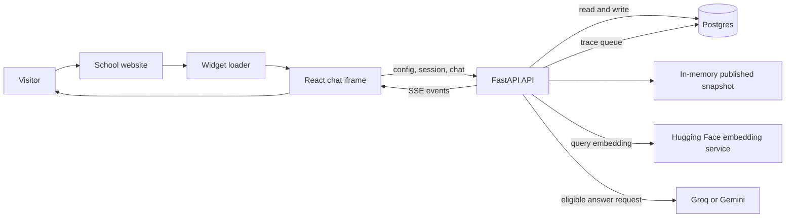
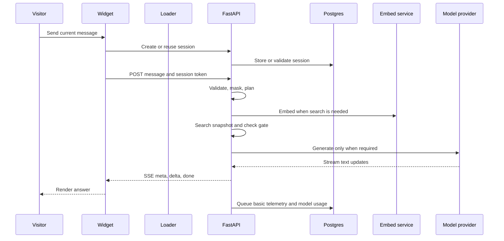
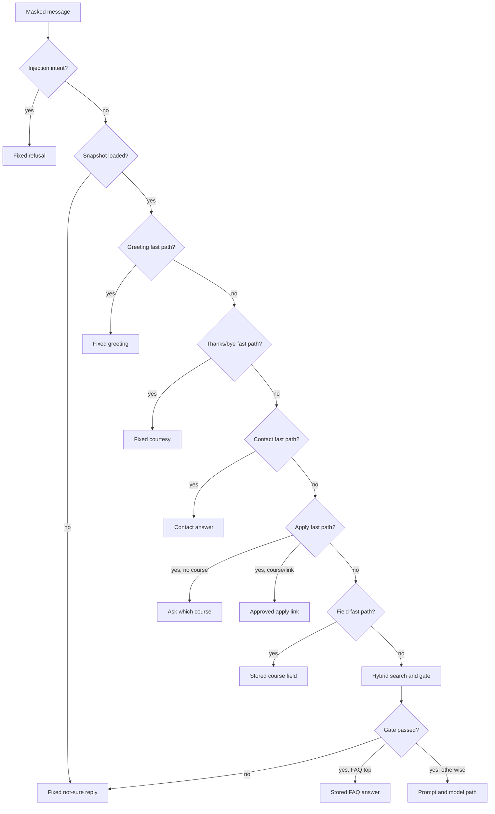
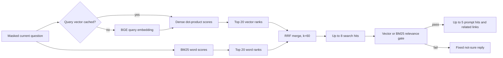
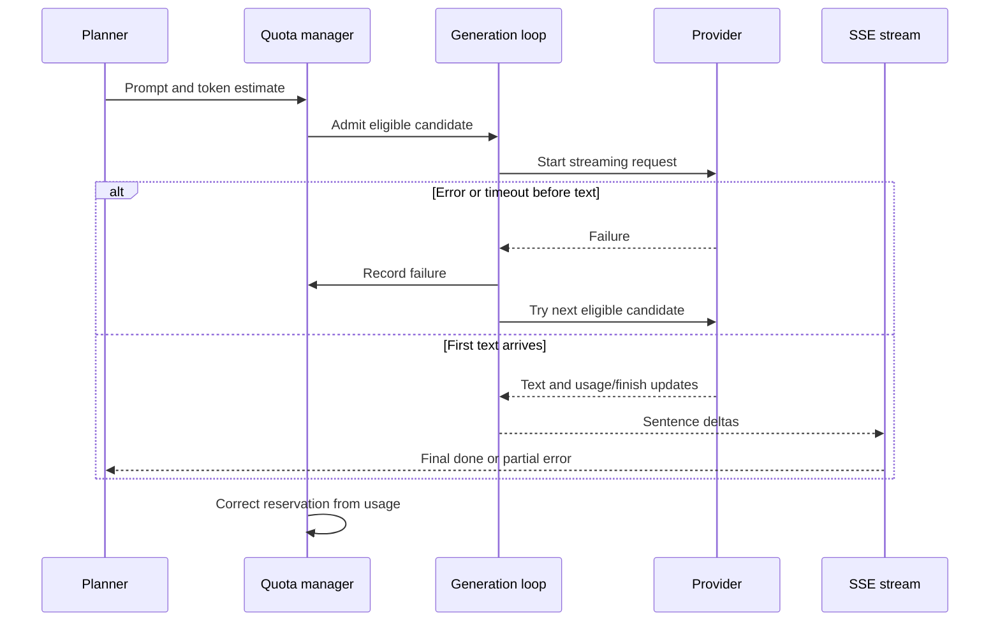
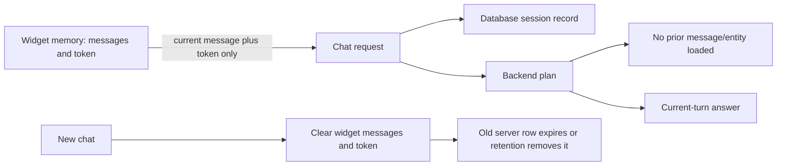
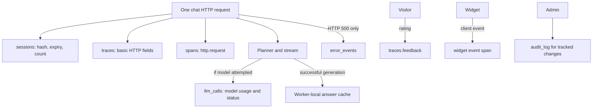
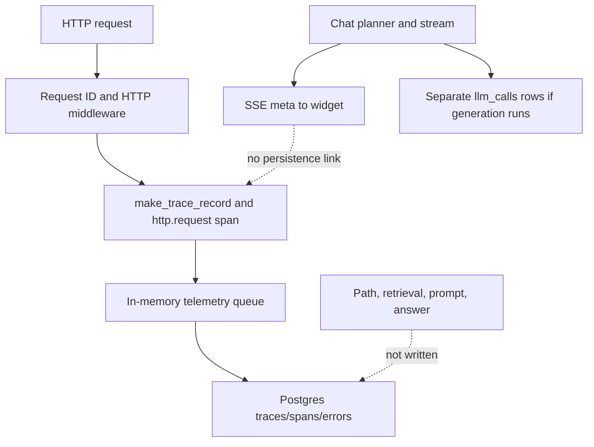

# ZIT Website Assistant: RAG Architecture Report

**Written against commit:** `a323ed9bc9e3c5650af638736a6e8131634cbbce`

GitHub renders Mermaid diagrams automatically. In VS Code, use a Markdown Mermaid preview extension. The numbered lists under each diagram remain readable without a diagram renderer.

## 0. Read this first

1. The website assistant is a React chat widget in an iframe and a Python FastAPI service.
2. The service loads published school content into memory and searches it before deciding whether a model is needed.
3. Code can answer greetings, contact, application, course-field, category, FAQ, and low-confidence questions without a language model.
4. The live search combines text similarity with BM25 keyword scoring, then merges ranks.
5. A new message is sent by itself. Earlier chat messages are not sent to the backend or model.
6. The supplied `Helllo` trace records the HTTP request, but not the answer path or the message.
7. An offline run against release 2 reproduces `Helllo` falling through to the fixed "not sure" answer.
8. The provider adapters support Groq and Gemini, but this investigation made no language-model calls.
9. The checked-in Vercel security header still names placeholder school domains.
10. Findings and suggested fixes are in section 15. No fixes were applied in this investigation.

### System overview diagram



1. The site includes a loader script, which creates the chat iframe when needed.
2. The iframe requests configuration, creates a session, and sends one message.
3. The API reads the session and its in-memory copy of the active content.
4. If search is needed, the API requests an embedding and searches its snapshot.
5. If the route reaches generation and a model is eligible, the API streams from a provider.
6. The API returns server-sent events to the iframe, and telemetry is queued for Postgres.

### Five most important findings

1. The trace has no intent, path, retrieval, prompt, or answer data. The streaming route never writes its plan into the `traces` row.
2. Greetings and thanks are checked before substantive questions. For example, "Hi, what courses do you offer?" returns only a greeting.
3. The current backend does not support conversational follow-up context. "And how long is it?" is searched as an unrelated standalone message.
4. The code and the build plan disagree on important features, including direct-FAQ conditions, search boosts, session history, and trace detail.
5. The Vercel CSP contains placeholder parent domains. If deployed as checked in, it does not authorize `zibeh.ng` to frame the widget.

**How to read this report:** Code references point to this checkout and include a function or class name. A claim marked **UNCONFIRMED** could not be established from the checked-in source or the read-only database evidence.

## 1. Plain-English glossary

- **API:** A defined way for two programs to exchange requests and responses.
- **Backend:** The server-side program that handles chat requests, searches content, and talks to providers.
- **BM25:** A word-matching score. It rewards useful word overlap and reduces the value of words that appear in many documents.
- **Cache:** Temporary memory that saves work or reuses a previous answer.
- **Circuit breaker:** A temporary rule that stops calls to a provider after repeated failures.
- **Chunk:** A small section of a document, stored and searched independently.
- **CORS:** A browser rule that lets the server allow only selected website origins to call it.
- **CSP:** Content Security Policy. A browser header that controls which sites may embed a page or load its resources.
- **Dense vector search:** A search that compares numeric representations of meaning.
- **Embedding:** A list of numbers made from text. Similar meanings tend to have similar lists.
- **ETL:** The steps that extract content, transform it, check it, and load it into the content database.
- **Failover:** Trying a different model when an earlier provider attempt fails before producing answer text.
- **Fast path:** A code branch that returns a fixed or content-based response without calling a language model.
- **FAQ direct:** Returning a stored FAQ answer directly instead of generating an answer.
- **Gate:** A relevance check that decides whether search results are strong enough to answer.
- **Hybrid search:** A search that combines meaning-based vector scores and BM25 word scores.
- **HTTP:** The standard request-and-response protocol used by browsers and web servers.
- **Iframe:** A web page embedded inside another web page. The chat is isolated in one.
- **Intent:** A detected topic such as greeting, fee, duration, or application.
- **JSON:** A structured text format used to exchange data between programs.
- **JWT:** A signed token format used to carry identity or authorization claims.
- **Kill switch:** A setting that makes the public assistant unavailable.
- **Language model:** A text-generation service. This report uses "model" for short.
- **Markdown:** A text format with simple markers for headings, lists, and links.
- **OpenTelemetry (OTel):** A standard for producing and exporting application traces and metrics.
- **OTLP:** OpenTelemetry Protocol, used to send OpenTelemetry data to a compatible service.
- **PII masking:** Replacing patterns that may identify a person, such as an email or phone number, before processing.
- **PostgreSQL (Postgres):** The relational database system used to store application records.
- **Prompt:** The text and retrieved facts sent to a language model.
- **Provider:** A company or service that hosts a language model or embedding model.
- **RAG:** Retrieval-augmented generation. The system searches stored facts and gives selected facts to a language model to help answer.
- **Quota:** A provider's limit on calls or tokens over a time period.
- **Regex:** A pattern used to find matching text, such as email addresses or phone numbers.
- **Reciprocal rank fusion (RRF):** A way to combine ranked search lists using each result's position, not by adding unlike raw scores.
- **Release:** A named, validated version of the published content.
- **Reference ID:** The request UUID shown to connect a widget error to server records.
- **Rollout:** The percentage of users allowed to use the assistant.
- **Session:** A short-lived server record that lets later requests be associated with the same visitor without storing a transcript.
- **Snapshot:** The active release copied into application memory for fast retrieval.
- **Span:** A recorded step within a request, such as the HTTP request span.
- **SSE:** Server-Sent Events, a text stream that lets the server send response updates over one HTTP connection.
- **SQLAlchemy:** The Python library used here to map application code to database records and queries.
- **Telemetry:** Operational records about requests, errors, and model calls.
- **TTL:** Time to live. How long a temporary value is kept before it expires.
- **Trace:** A record that identifies one HTTP request and may link its spans and model calls.
- **UUID:** A long, unique identifier used here for request and session records.
- **Vercel:** A hosting service configured here to build and serve the static widget.
- **Vite:** The frontend build and development tool configured for the widget.
- **Widget:** The React user interface embedded into the school website.
- **Worker-local:** Data held in one running server process. Other server processes do not automatically share it.

## 2. The big picture

### Components and where they run

| Part | What it does | Where it runs |
| --- | --- | --- |
| School website | Hosts the loader script and receives widget open/close messages. | The school's website origin. The production integration is not represented in this repository. |
| Loader | Fetches public config, creates a launcher, and lazily creates a sandboxed iframe. | In the school page's browser. `widget/src/loader/loader.ts:27`, function `installLoader`. |
| Chat iframe | React application. It holds visible messages, the current session token, and streaming state in memory. | Browser, served as a Vite-built static widget. `widget/src/App.tsx:29`, function `App`. |
| Backend | FastAPI routes, session checks, retrieval, model providers, and telemetry. | Local development uses `app.main:app`; `app/main.py:46`, function `create_app`. The exact production host is **UNCONFIRMED** from the checked-in deployment files. |
| Postgres | Stores published content, sessions, API keys, traces, spans, model-call records, and admin changes. | Database service reached by the backend. The checked-in code uses SQLAlchemy async sessions. |
| Active snapshot | Read-only in-memory objects for the active release's chunks, embeddings, and links. | Each backend process. `app/content/snapshot.py:83`, function `load_active_snapshot`. |
| Embedding service | Returns a 768-number BGE embedding for a search query. | Remote HTTPS origin from the local settings: `https://johnalbarkaibrahim-sentimentscope.hf.space`. |
| Model providers | Groq and Gemini streaming adapters. | Remote provider APIs, called by the backend only when generation is reached. `app/chat/runtime.py:11`, function `get_providers`. |

The local Vercel config builds the widget as a static Vite site. The backend repository also contains a Dockerfile, but that does not prove which production host runs it. The owner has said the backend is deployed. The exact deployed backend host and deployed commit remain **UNCONFIRMED** from this checkout.

The locally loaded eligible model list is:

- Groq: `openai/gpt-oss-120b`, `openai/gpt-oss-20b`.
- Gemini: `gemini-3.1-flash-lite`, `gemini-3.5-flash-lite`, `gemini-3.6-flash`, `gemini-3.8-flash`.

The model list is taken from the local `Settings()` object and only model IDs and quota metadata were printed. Provider keys were not printed. The `free_confirmed` flag is configuration, not independent evidence about billing in the provider account.

## 3. One message, step by step

1. **The loader starts the widget.** The loader reads its API and widget URLs, requests `/api/v1/config`, and does not create its launcher if the returned config is disabled. It creates the iframe only when opened. `widget/src/loader/loader.ts:27`, function `installLoader`; `widget/src/loader/loader.ts:167`, function `getEnabledConfig`. The loader's config request is also repeated by the iframe. A network/config error leaves the widget unavailable.
2. **The iframe checks parent messages.** It accepts init messages only from `window.parent` and an exact configured origin, then validates the API URL. `widget/src/state/bridge.ts:16`, function `connectParent`; `widget/src/state/bridge.ts:41`, function `isTrustedInitEvent`. A wrong host origin is rejected.
3. **The visitor types a message.** The textarea limits input to 500 characters. The send action is a `type="button"` click or Enter-key handler, not a native form submission. `widget/src/components/Composer.tsx:34`, component `Composer`; `widget/src/components/Composer.tsx:66`, function `handleComposerKeyDown`. Browser offline state, active streaming, cooldown, and config also disable sending. `widget/src/state/message-stream.ts:42`, function `canSendQuestion`.
4. **The widget stores display state.** The visitor's message and a blank assistant message are appended to React state. The messages are not written to local storage or sent as history. `widget/src/App.tsx:184`, function `sendQuestion`.
5. **The widget creates or reuses a session.** The token is held in the `SessionManager` instance in iframe memory. A missing token causes `POST /api/v1/sessions`; an expired token is cleared and the request is tried once with a new session. `widget/src/state/chat.ts:11`, function `streamWithSession`; `widget/src/state/session.ts:3`, class `SessionManager`.
6. **The API client sends only the current message and token.** It uses `fetch` with JSON and `Accept: text/event-stream`. It does not send earlier messages. `widget/src/api/client.ts:21`, function `createApiClient`.
7. **The browser and server check origin and request shape.** CORS allows exact origins in `WIDGET_ORIGINS`, no credentials, and selected methods/headers. The request model requires 1 to 500 characters; the route also checks `MESSAGE_MAX_CHARS`. `app/main.py:46`, function `create_app`; `app/api/public/chat.py:31`, class `ChatRequest`; `app/api/public/chat.py:116`, function `chat_stream`. A browser CORS rejection may not expose the response body to JavaScript.
8. **The middleware creates a request ID.** It creates a UUID, binds it to log context, then enqueues a basic trace and `http.request` span after handling the request. HTTP 500 responses also enqueue an error event. `app/api/middleware.py:22`, function `request_context_middleware`; `app/obs/writer.py:230`, function `make_trace_record`. Queue persistence can be delayed or fail.
9. **The route checks session and capacity.** It checks rollout, message length, token validity and expiry, the per-session rate limit, and whether another request is active for this session. The active-request set and limiters are in process memory. `app/api/public/chat.py:116`, function `chat_stream`; `app/api/public/chat.py:177`, function `_require_rollout`; `app/chat/limits.py:7`, class `SlidingWindowLimiter`.
10. **The backend masks likely PII.** It sends masked text into planning and retrieval. The original request object still exists in the HTTP process, but the inspected request logging does not log its body. `app/chat/pii.py:18`, function `mask_pii`; `app/api/public/chat.py:149`, function `chat_stream`.
11. **The planner chooses a path.** Injection refusal and missing snapshot are checked first. Then fixed fast paths run in order. Only if none returns does it embed and search. `app/chat/retrieval.py:39`, function `prepare_chat_plan`; `app/chat/retrieval.py:98`, function `_fast_response`.
12. **Search may build a prompt.** The API searches the in-memory snapshot, checks the relevance gate, and either returns a fixed fallback, returns a direct FAQ, or builds a prompt for the model. The answer cache is checked after planning, so a cache hit still incurs planning and search work. `app/chat/streaming.py:32`, function `stream_chat`.
13. **Generation may call a model.** Eligible models are checked against the quota manager. The backend tries candidates until the first text or until the attempt/deadline limits are exhausted. Once text is sent, it does not fail over to another model. `app/chat/generation.py:49`, function `begin_generation`; `app/chat/streaming.py:32`, function `stream_chat`.
14. **The API returns SSE.** It sends metadata, text deltas, optional error information, and a final done event. Fixed replies use the same event stream. `app/api/public/chat.py:260`, function `_sse`; `app/chat/streaming.py:32`, function `stream_chat`.
15. **The widget parses events and updates the assistant message.** It appends each delta, records metadata, and marks errors or a missing final done event as incomplete. `widget/src/api/sse.ts:21`, function `readSse`; `widget/src/state/message-stream.ts:22`, function `recordStreamEvent`; `widget/src/App.tsx:291`, function `applyStreamResult`.
16. **The backend updates the session and relevant telemetry.** It increments the session turn count. It writes `llm_calls` only when generation attempts occur. It does not save a message transcript. `app/chat/streaming.py:432`, function `_update_session`; `app/chat/streaming.py:380`, function `_llm_call`.

### Three worked examples

| Message | What the current code does |
| --- | --- |
| `Hello` | The greeting regex matches. The greeting fast path returns a fixed welcome. No embedding or model call is made. |
| `What are the fees for the data analysis course?` | Intent is `fee`. No exact course entity is matched, so field lookup cannot answer. Search returns best vector `0.661012` and BM25 `0.289096`; the vector passes the `0.62` gate. Five chunks are planned for a model. The offline helper does not call the model. |
| `and how long is it?` after the fee question | The backend receives only the follow-up, not the earlier question. No course entity is matched. Best vector is `0.534810`, BM25 is `0.0`, both below the gate, so it returns the fixed not-sure answer. |

Evidence: `scripts/explain_query.py` was run against active release 2. The first and third messages require a query embedding; the second does too. No language-model request was made.

### One message end to end



1. The visitor sends one current message from the widget.
2. The widget creates a session first if it has no in-memory token.
3. FastAPI validates the token and request, then masks likely PII.
4. Search uses the embedding service only when no earlier fixed path returns.
5. A model provider is called only if the gate passes and no direct answer applies.
6. The widget renders SSE updates. The API separately queues whatever telemetry is implemented.

## 4. How the backend chooses the kind of answer

The order below is the actual order in `prepare_chat_plan` and `_fast_response`, not the order in the build plan.

1. **Injection refusal.** If the `injection` intent pattern matches, return `I can only help with accurate information about ZIT and its services.` No setting controls this. `app/chat/retrieval.py:39`, function `prepare_chat_plan`.
2. **Missing snapshot.** If no active snapshot is loaded, return `I'm not sure based on the information available. Please contact ZIT Admissions for help.` This takes priority over all fast paths. `app/chat/retrieval.py:39`, function `prepare_chat_plan`.
3. **Greeting.** If `FAST_GREETING` is true and the greeting intent is detected, return `Hello! I can help with ZIT courses, fees, duration, and applications.` `app/chat/retrieval.py:98`, function `_fast_response`.
4. **Thanks or bye.** If `FAST_THANKS_BYE` is true and the `thanks_bye` intent is detected, return `You're welcome. Let me know if I can help with ZIT information.` `app/chat/retrieval.py:98`, function `_fast_response`.
5. **Contact.** If `FAST_CONTACT` is true and contact intent is detected, return a contact-link message when the approved admissions link exists. Otherwise return `Please contact ZIT Admissions for assistance.` `app/chat/retrieval.py:272`, function `_contact_plan`.
6. **Apply.** If `FAST_APPLY` is true and apply intent is detected without an entity, return `Which ZIT course would you like to apply for?` If an entity and approved apply link exist, return an apply-link response. If an entity exists but has no approved apply link, code continues to search. `app/chat/retrieval.py:98`, function `_fast_response`.
7. **Field lookup.** If `FAST_FIELD` is true, a course entity matches, and the message contains fee, duration, requirements, or scholarship intent, return a stored metadata value when present. Tuition adds `This is as of the release date; please confirm with Admissions.` If no entity or value matches, continue to search. `app/chat/retrieval.py:98`, function `_fast_response`; `app/chat/retrieval.py:206`, function `_field_for_intent`.
8. **Category/list.** If `FAST_CATEGORY` is true and `list_courses` matches, return `Courses in that category include: ...` for category matches. If none are found, return `Which course category are you interested in?` `app/chat/retrieval.py:245`, function `_category_response`.
9. **Search and relevance gate.** Search runs only after the above. If the best vector score is below `GATE_VECTOR_MIN` and the best BM25 score is below the applicable BM25 threshold, return the fixed not-sure text. There is no entity-based gate bypass in this code. `app/chat/retrieval.py:39`, function `prepare_chat_plan`.
10. **FAQ direct.** After the gate passes, if `FAST_FAQ` is true and the top result's doc key starts with `faq:`, return the result text as-is. The code does not test the FAQ `direct` metadata flag or `FAQ_DIRECT_SIM`. `app/chat/retrieval.py:39-73`, function `prepare_chat_plan`.
11. **Model-written answer.** If the gate passes and the FAQ branch does not return, build a prompt and proceed to generation. No fixed answer is defined for this path. `app/chat/retrieval.py:86`, function `prepare_chat_plan`.
12. **Capacity fallback.** If no model can produce a first text within the configured attempt/deadline limits, return `Please contact ZIT Admissions for help with this question.` The stream marks this as degraded. `app/chat/streaming.py:29`, constant `_CAPACITY_ANSWER`; `app/chat/streaming.py:91`, function `stream_chat`.

When multiple intents match, the earliest enabled branch wins. Therefore a message that begins with `Hi` and also asks a course question can stop at greeting. A message containing both `thanks` and `fees` can stop at thanks.



1. Injection and missing-snapshot exits happen before the fast paths.
2. Enabled fast paths are checked in their listed order.
3. The first matching fixed path returns immediately.
4. Only messages that reach search are evaluated by the relevance gate.
5. A gated FAQ can answer directly; other passing search results can reach generation.

## 5. How search works

1. The search string is the masked current message. There is no query rewrite, page context, prior-message summary, or previous course entity in the search request. `app/chat/retrieval.py:39`, function `prepare_chat_plan`.
2. The query embedding client discovers and validates the remote model metadata. It sends `model`, `input`, `input_type: query`, and `normalize_embeddings: true` to `/v1/embeddings`. The returned vector must have 768 values. `app/embeddings/client.py:42`, class `BgeEmbeddingClient`.
3. Query vectors are cached in a worker-local, ordered cache of up to 512 entries. The configured `SESSION_CACHE_SECONDS` value is 300 seconds locally. Embedding requests have a 100-second timeout, a 5-second connect timeout, and the client retries 429, 503, and 504 responses by default. `app/chat/retrieval.py:306`, function `_query_vector`; `app/embeddings/client.py:42`, class `BgeEmbeddingClient`.
4. Vector search compares the query with every stored chunk vector using a dot product. Chunk vectors are validated as normalized 768-dimensional vectors when the snapshot loads. `app/search/hybrid.py:124`, method `_vector_scores`; `app/content/snapshot.py:233`, function `_valid_embedding`.
5. BM25 scores the tokenized question against `embed_text`, chunk text, and doc key. The tokenizer lowercases, strips punctuation, keeps numbers, and removes a short stopword list. It is implemented in this repository. `app/search/hybrid.py:55`, class `InMemoryHybridSearch`; `app/search/hybrid.py:179`, function `_tokens`.
6. Each list contributes its top 20 ranked chunk keys. RRF uses `k=60`. The merged search returns up to 8 hits. `app/search/hybrid.py:71`, method `retrieve`.
7. The gate uses the best vector score and best BM25 score, not the fused score. Normal mode requires either vector score at least `0.62` or BM25 score at least `0.30`. If no query vector exists, the BM25 threshold is stricter at `0.45`. `app/chat/retrieval.py:39`, function `prepare_chat_plan`; defaults are in `app/config.py:12`, class `Settings`.
8. At most five hits are used for prompt generation. Link keys are gathered from their metadata and mapped to the active snapshot's link records. The code has no explicit five-link cap. `app/chat/retrieval.py:291`, function `_links_for_hits`.
9. If the embedding service is unavailable, the code logs the error type, continues with BM25-only search, and uses the degraded threshold. If no embedding credential is configured, it also searches BM25 only. `app/chat/retrieval.py:306`, function `_query_vector`.

The database stores the release data and vectors. At startup, the service copies the published release into `ContentSnapshot` objects in process memory. Search itself does not query Postgres. A successful publish or rollback can reload the active snapshot through the admin release route. `app/content/snapshot.py:83`, function `load_active_snapshot`; `app/api/admin/release_routes.py:381`, function `reload_snapshot`.

Important differences from the build plan:

- The plan describes entity, page, and intent boosts, a guaranteed entity summary, per-document caps, and a prompt-context cut during retrieval. The live `InMemoryHybridSearch.retrieve` uses rank fusion only. Those boosts and caps are not in the live search implementation. Compare `misc/ZIT Website Assistant MVP Build Plan.md:615`, section 8.4, with `app/search/hybrid.py:71`, method `retrieve`.
- The plan describes an entity-based gate bypass. The live gate checks only vector and BM25 scores. Compare `misc/ZIT Website Assistant MVP Build Plan.md:628`, section 8.5, with `app/chat/retrieval.py:39`, function `prepare_chat_plan`.
- Entity matching checks exact normalized aliases from chunk metadata. It does not use fuzzy matching. A candidate must have at least four normalized characters. `app/chat/retrieval.py:175`, function `_match_entity`.
- `FAQ_DIRECT_SIM` exists in Settings, but the live FAQ branch does not read it. Search of the live app found its definition only in `app/config.py:46`, setting `faq_direct_sim` on class `Settings` (`app/config.py:12`).



1. The current question is both embedded and tokenized for search.
2. Vector and BM25 rankings are calculated separately.
3. Their ranks are merged with RRF, then trimmed to eight hits.
4. The gate checks the best individual vector and BM25 values.
5. A passing result supplies at most five hits to the next answer step.

## 6. The prompt and the language model

### Prompt contents

`build_prompt` creates one text prompt in this order:

1. The assistant role and the rule to answer only from public ZIT context.
2. A warning that retrieved text is untrusted and may contain instructions to ignore.
3. A rule not to invent facts, fees, dates, phone numbers, or URLs.
4. A rule to keep tuition and duration as written and qualify tuition with the release-date warning.
5. Up to five retrieved chunks, limited by a rough 1,800-token estimate for chunk text.
6. Approved link labels and URLs, if any.
7. The visitor's current masked question.

The exact prompt is assembled by `app/chat/prompt.py:11`, function `build_prompt`; context selection is in `app/chat/prompt.py:38`, function `_bounded_context`. It does not include conversation history, today's date, or a separately formatted release date. There is no lean/full mode in the live prompt code.

### Model selection and limits

- Models are filtered to those marked both enabled and free-confirmed, then sorted by tier and model ID. `app/chat/models.py:20`, function `parse_llm_models`; `app/chat/models.py:54`, function `eligible_models`.
- The local list has six eligible models, but `LLM_MAX_ATTEMPTS=3` means only the first three sorted candidates are considered in one generation attempt. In the local configuration these are the two Groq models, followed by `gemini-3.1-flash-lite`.
- Each model receives a maximum of 600 output tokens. The input estimate uses roughly one token per four characters. The generation reserves estimated input plus 600 output tokens before the call. `app/chat/generation.py:14`, constant `MAX_OUTPUT_TOKENS`; `app/chat/generation.py:49`, function `begin_generation`.
- The total pre-token deadline is 12 seconds and the first-token timeout is 8 seconds locally. If a candidate fails before any text, the next eligible candidate may be tried. Once a model emits first text, the code does not switch models.
- Quota counters are in memory. The code reserves calls and tokens using each configured model's limits and safety margins. Unknown limits use fallback caps of 10 requests/minute, 100 requests/day, 4,000 tokens/minute, and 40,000 tokens/day. Three consecutive failures open the model breaker for at least 30 seconds. `app/chat/quota.py:35`, class `QuotaManager`.
- At startup, recent `llm_calls` rows from the last day are used to rebuild quota counters. The startup query is capped at 10,000 rows. `app/main.py:46`, function `create_app`.
- Groq and Gemini provider adapters each send one prompt string. The provider adapters extract usage and finish reason updates. `app/chat/providers.py:48`, class `GroqProvider`; `app/chat/providers.py:98`, class `GeminiProvider`.

### Answer validation and when no model is called

Before emitting generated text, the backend rejects URLs not in the approved link list and phone numbers that do not appear in retrieved context. It does not validate every factual statement or prove every claim with a citation. `app/chat/answer.py:13`, function `answer_is_grounded`.

No model is called for injection refusal, missing snapshot, greeting, thanks/bye, contact, apply, successful field lookup, category response, failed relevance gate, direct FAQ, or a usable answer-cache hit. The cache hit still occurs after planning and search. If there are no eligible provider attempts or all first-token attempts fail, the visitor gets the capacity fallback.



1. The quota manager checks candidate limits and reserves estimated tokens.
2. A provider call is attempted until first text, a timeout, or the attempt limit.
3. Failover is possible only before first text.
4. After first text, validated sentence deltas go to SSE; failures produce partial/error handling.
5. The quota reservation is corrected when actual usage is known.

## 7. Streaming

The backend sends JSON data in SSE frames. The event names are `ping`, `meta`, `delta`, `error`, and `done`. `ping` carries `{}`. `meta` contains request ID, release ID, path, intent, approved links, and degraded status. `delta` carries text in `t`. `error` carries a code. `done` carries finish, actions, and degraded status. `app/api/public/chat.py:260`, function `_sse`; `app/chat/streaming.py:298`, function `_meta`.

Typical order:

1. Zero or more pings while planning or waiting for the first model text.
2. One meta event, then zero or more deltas.
3. Optional error after partial text.
4. A done event.

The capacity path can send a second `meta` event with `path: capacity` before its fallback delta. Fixed answers send meta, delta, done. Provider text is buffered into complete sentences before deltas are emitted. `app/chat/streaming.py:32`, function `stream_chat`; `app/chat/streaming.py:286`, function `_emit_complete_sentences`.

The widget buffers network chunks until SSE frame boundaries, validates known event shapes, appends deltas, and marks a response incomplete if it receives an error or the stream ends without `done`. `widget/src/api/sse.ts:21`, function `readSse`; `widget/src/state/message-stream.ts:22`, function `recordStreamEvent`; `widget/src/App.tsx:291`, function `applyStreamResult`.

The checked-in API contract matches the main event names and payloads. `API_CONTRACT.md:206`, section "SSE format and event contract". It correctly notes that a second meta event can precede capacity fallback. The build plan is older: it specifies `sources`, `actions`, `retryable`, `partial`, and an error `request_id`; the current code does not send those fields. Compare `misc/ZIT Website Assistant MVP Build Plan.md:742`, section 9.5, with `app/chat/streaming.py:298`, function `_meta`, and the `error` emissions in `app/chat/streaming.py:114-225`, function `stream_chat`.

## 8. Conversation history and memory

- **Does the backend retain previous chat text?** No runtime transcript is stored. The `sessions` table has a JSON `state` field initialized to `{}`, plus a turn counter and timestamps. The stream updates the counter and `last_seen_at`, but does not append a message or entity to `state`. `app/chat/session_store.py:20`, function `create_session_record`; `app/chat/streaming.py:432`, function `_update_session`.
- **Does the widget keep previous messages?** Yes, in React state while the iframe remains open. New chat clears that state and clears the in-memory session token. `widget/src/App.tsx:29`, function `App`; `widget/src/App.tsx:357`, function `startNewChat`.
- **Does it persist those messages in browser storage?** No chat transcript is written to browser storage. The loader uses session storage for launcher preferences. The privacy notice dismissal also uses session storage. `widget/src/loader/loader.ts:238`, function `safeStorageGet`; `widget/src/App.tsx:469`, function `readPrivacyDismissed`.
- **Does the widget send earlier messages?** No. The API client body contains only `message` and `session_token`. `widget/src/api/client.ts:21`, function `createApiClient`.
- **Does the backend send earlier messages to a model?** No. The prompt builder receives only the current question, hits, and links. `app/chat/prompt.py:11`, function `build_prompt`.
- **How are follow-ups understood?** They are not resolved from prior turns. `and how long is it?` is independently embedded and searched. It has no matched course entity, scores vector `0.534810` and BM25 `0`, fails the gate, and returns the fixed not-sure reply.
- **How long does a session last?** The local TTL is 30 minutes and maximum age is four hours. The session row is later removed after 30 days without activity by the nightly retention job. `app/config.py:78`, class `Settings`; `app/ops.py:15`, function `run_retention`.
- **What happens when a session expires?** The API rejects it. The widget clears the token and retries the chat once after creating a new session. `widget/src/state/chat.ts:11`, function `streamWithSession`.
- **What is saved about message text?** The inspected request path masks PII before planning, but does not write user or assistant text into the trace, session, or a transcript table. The trace schema has optional text columns, but the active trace writer does not populate them. See section 9.



1. Earlier messages remain visible only in the open widget's React state.
2. The request payload contains the current message and session token, not that state.
3. The backend session state is initialized empty and is not updated with course context.
4. New chat clears browser memory, while the old database session row remains until expiry/retention.

## 9. Tracing, logs, and everything stored

### What a request can write

| Record | When written | What it contains in this implementation | Text/privacy note |
| --- | --- | --- | --- |
| `sessions` | Session creation, token validation, and stream completion. | Keyed token hash, IP and user-agent hashes, expiry, turn count, timestamps, state. | No message text. `state` starts empty. |
| `traces` | HTTP middleware queues one basic record per request. | Request ID, kind, time, duration, status, route, and sometimes session ID. Most rich trace columns remain null. | No message or answer text in the active writer. Schema has columns that could hold them, but the path does not set them. |
| `spans` | HTTP middleware queues one `http.request` span. Client feedback/error events can add a widget span to a chat trace. | Route, HTTP status, event name, timing and status. | No raw message text in the observed attributes. |
| `llm_calls` | A provider attempt is recorded after first text or on a failed pre-token attempt. | Provider, model, status, timings, usage, output cap, finish reason, and error class. | No prompt or answer text. |
| `error_events` | Middleware sees an HTTP status of 500 or higher. | Generic `Request failed` message, route, status code. | No request body or visitor text. |
| Feedback | `POST /api/v1/feedback` succeeds. | Rating is written into `traces.feedback`. | No separate feedback table. |
| Client events | `POST /api/v1/client-events` succeeds. | A `widget.response_error` or `widget.feedback_submitted` span is attached to the supplied chat trace. | No separate client-event table. |
| Answer cache | A validated generated answer completes successfully. | Worker-local exact-question hash, answer, release ID, and expiry. | The cache does not store the original question as its key, but it does hold answer text in memory. |
| Query embedding cache | A query embedding succeeds. | Worker-local SHA-256 key and vector, up to 512 entries. | No raw question stored as the cache key. |
| `audit_log` | An admin operation makes a tracked change. | Actor, action, target, before/after, related request ID. | May contain admin content values; not part of ordinary chat turns. |
| Logs | HTTP completion and selected component events. | Structured logs include route, status, duration, request ID, component, and error type as applicable. | The middleware does not log the request body. Embedding failure logs the exception type, not the visitor's message. |

The `Trace`, `Span`, `SessionRecord`, `ErrorEvent`, and `LLMCall` schemas are in `app/db/models.py:69`, class `Trace`; `app/db/models.py:109`, class `Span`; `app/db/models.py:128`, class `ErrorEvent`; `app/db/models.py:143`, class `SessionRecord`; and `app/db/models.py:461`, class `LLMCall`.



1. A request can update an existing session and enqueue a basic trace/span.
2. Model-call rows exist only when generation attempts are made.
3. Answer and query caches are in process memory, not database tables.
4. Feedback is a trace field; supported browser events are spans.
5. The ordinary chat path does not save a message transcript.

### Why the supplied trace has no path or retrieval details

The trace ID is `ecb42b70-36f6-4eff-8059-e9405b11d99c`. A read-only database query found:

| Field | Stored value |
| --- | --- |
| `kind` | `client` |
| `started_at` | `2026-11-26 19:02:06.378991+00` |
| `duration_ms` | `2109` |
| `status` | `ok` |
| `route` | `/api/v1/chat/stream` |
| `session_id` | `d6e521c7-db44-4d66-891a-4aba244b7f1a` |
| `release_id`, `intent`, `path`, `provider`, `model`, `tier`, `attempts`, `ttfw_ms`, `tokens_in`, `tokens_out` | All `null` |
| `confidence`, `retrieved`, `link_map`, `stages`, `prompt_sections`, `flags`, `review` | All `null` |
| `user_text`, `answer_text`, `feedback` | All `null` |
| linked `spans` | One `http.request` span, status `ok`, route `/api/v1/chat/stream`, HTTP status `200` |
| linked `llm_calls` | None |

The screenshot supplied with the task shows the visitor typed `Helllo`. The database row does not store the original message, so it cannot independently prove that text or the response. The offline reproduction in section 14 shows that `Helllo` reaches the not-sure path with the current release and settings.

The exact reason for missing path data is in the code:

1. `request_context_middleware` creates a basic trace and span from the HTTP response. It does not receive a `ChatPlan`. `app/api/middleware.py:22`, function `request_context_middleware`.
2. `make_trace_record` sets only trace ID, request kind, time, duration, HTTP status, error code, and route. `app/obs/writer.py:230`, function `make_trace_record`.
3. `stream_chat` emits path, intent, release, links, and degraded state to the widget as `meta`, but does not update the persisted `Trace`. `app/chat/streaming.py:298`, function `_meta`.
4. Model usage is written to separate `llm_calls` rows only if generation is attempted. This supplied trace has no linked rows. `app/chat/streaming.py:352`, function `_record_generation`.
5. The schema contains richer fields, but a schema column does not populate itself. The admin detail endpoint returns only a summary of trace fields, spans, and selected LLM-call fields. `app/api/admin/routes.py:134`, function `get_trace`.

The build plan promises path, intent, release, retrieval, prompt sections, custom spans for each RAG stage, and sanitized user and answer text. `misc/ZIT Website Assistant MVP Build Plan.md:462`, table definition for `traces`; `misc/ZIT Website Assistant MVP Build Plan.md:881`, tracing stages; `misc/ZIT Website Assistant MVP Build Plan.md:904`, saved tracing data. Those details are not filled by the current middleware/writer path.

### Admin trace inspection

- `GET /admin/v1/traces` lists trace ID, kind, time, duration, status, error code, and route. `app/api/admin/routes.py:191`, function `list_traces`.
- `GET /admin/v1/traces/{trace_id}` returns that trace summary plus spans and selected LLM-call fields. It does not return the model's prompt or response. `app/api/admin/routes.py:134`, function `get_trace`.
- `GET /admin/v1/errors` lists recent error-event metadata. `app/api/admin/ops_routes.py:22`, function `list_errors`.
- `GET /admin/v1/llm-calls` lists recent model-call details. `app/api/admin/ops_routes.py:44`, function `list_llm_calls`.
- Admin authentication updates `api_keys.last_used_at` and commits it. Therefore an admin GET is not strictly read-only at the database level. `app/api/deps.py:19`, function `get_admin_principal`.

### Logs and OpenTelemetry

The middleware logs request method, route, HTTP status, and duration. The telemetry writer queues traces, spans, and errors in memory and persists them in batches. `app/obs/writer.py:24`, class `TelemetryWriter`. The app instruments FastAPI, HTTPX, and SQLAlchemy, but the checked-in instrumentation does not attach an exporter. `OTLP_ENDPOINT` is defined in Settings but is not consumed by this code path. `app/obs/instrumentation.py:19`, function `instrument_application`.

Sentry is disabled in the local settings probe. Its event hook removes request data, cookies, headers, query strings, and user data when enabled. `app/obs/sentry.py:9`, function `_remove_sensitive_request_data`.



1. The middleware can see HTTP route and status, but not the `ChatPlan`.
2. It queues a basic trace and span for database persistence.
3. The chat stream sends richer routing metadata to the browser only.
4. Model usage uses separate rows, so it cannot fill the missing trace fields.
5. As a result, the schema can contain rich columns while the stored trace leaves them empty.

### Investigation side effect disclosure

During the investigation, I accidentally called the local `GET /api/v1/config` endpoint while checking public settings. The middleware writes a generic trace and span for every request. A read-only query found trace `74432489-28c7-43cd-9baa-b84817fc7d93` at `2026-11-26 20:58:45.682518+00`, route `/api/v1/config`, status `ok`. The database does not record the HTTP method in this trace row, so attribution is based on the matching route and time. This was an unintended telemetry write. No direct SQL write, migration, or other database mutation was performed.

## 10. Safety and limits

- Message length is limited to 500 characters by both the widget and the local backend setting. The API schema also caps it at 500.
- Sessions expire after 30 minutes of inactivity, with a four-hour maximum age. Session tokens are random and stored as a keyed hash. `app/chat/sessions.py:10`, function `create_session_token`; `app/chat/session_store.py:20`, function `create_session_record`.
- Session creation is limited to 10/minute and chat requests to 30/minute per hashed client/session key locally. One request at a time is enforced per session in an in-memory set.
- These limiters, the quota manager, active-session set, and caches are process-local. Multiple server workers or replicas do not share their counters. The checked-in Dockerfile uses one worker, but production replica count is **UNCONFIRMED**.
- CORS allows exact HTTP(S) origins listed in `WIDGET_ORIGINS`; credentials are disabled. The local value contains localhost and 127.0.0.1 origins on ports 5173 and 4173.
- `TURNSTILE_ENABLED` is false locally. Its secret is configured, but the route does not use it while the flag is false.
- The injection filter is a set of regular expressions. A match returns a fixed refusal before retrieval. It is not a general-purpose prompt-injection detector. `app/search/intent.py:5`, constant `INTENT_PATTERNS`; `app/chat/retrieval.py:39`, function `prepare_chat_plan`.
- PII masking catches common email, contiguous Nigerian phone, 11-digit NIN/BVN, and date-of-birth formats. It does not guarantee anonymization. Verified examples are in section 16.
- Formatted phone numbers with spaces are not caught by the current phone expression. A normal contiguous phone such as `08031234567` is caught.
- The admin IP allowlist is empty locally, which means the IP filter allows requests from any address before API-key validation. Admin API keys still require a valid Bearer key and a matching scope. `app/api/deps.py:19`, function `get_admin_principal`.
- Local admin API docs are enabled and HTTP Basic credentials are set. No credential values are included in this report. `app/api/admin/docs.py:12`, function `register_admin_docs`.
- The checked-in Vercel content security policy lists `your-school.example` placeholder origins. See finding 1 in section 15.

## 11. Content and releases

Content import validates a crawl archive and manifest, parses site pages and course markdown, creates document chunks and candidate links, then stages a draft. `app/content/importer.py:65`, function `load_crawl_import`; `app/content/site.py:31`, function `build_site_content`; `app/content/course.py:51`, function `build_course_chunks`; `app/content/staging.py:47`, function `stage_crawl`.

An active release is a published set of chunks and links. At startup, the backend loads it into memory. Publishing and rollback update the active release and reload the snapshot. Release evaluation runs retrieval cases before publication. `app/api/admin/release_routes.py:99`, function `evaluate_release`; `app/api/admin/release_routes.py:218`, function `publish_release`; `app/api/admin/release_routes.py:291`, function `rollback_release`.

The read-only database query found active release 2 with 65 distinct documents, 274 chunks, and 114 links. The vectors live in the content database and are copied into memory for search. They are not queried through a database vector index in the chat path.

The plan estimated about 350 chunks. The current release has 274. This is a count difference, not evidence of a defect by itself. `misc/ZIT Website Assistant MVP Build Plan.md:21`, content-size estimate.

## 12. Settings that change behavior

The defaults below are from `Settings` in `app/config.py:12-88`. Effective values are from a safe local `Settings()` probe. The public config endpoint also confirmed enabled status, 100 percent rollout, and an empty maintenance message. Other effective values were not fetched from the running HTTP process, so they could differ if that process started with different environment overrides. Secret values were never printed. Runtime settings are loaded when the app starts unless code explicitly reads a database setting.

| Setting | Code default | Local effective value | Effect and change method |
| --- | --- | --- | --- |
| `ENV` | `dev` | `dev` | Runtime environment. Restart to change. |
| `DATABASE_URL`, `DATABASE_URL_SESSION`, `DATABASE_URL_DIRECT` | unset | set | Database connection secrets. Restart to change. |
| `ZIT_API_KEY` | unset | set | Embedding API credential. Restart to change. |
| `EMBEDDING_API_BASE_URL` | Hugging Face Space URL | `https://johnalbarkaibrahim-sentimentscope.hf.space` | Embedding service origin. Restart to change. |
| `EMBEDDING_MODEL` / `EMBEDDING_DIMENSIONS` | `bge-base-768-v1` / `768` | same | Selected vector model and size. Restart to change. |
| `EMBEDDING_TIMEOUT_SECONDS` | `100` | `100` | Embedding HTTP timeout. Restart to change. |
| `GATE_VECTOR_MIN` | `0.62` | `0.62` | Minimum dense score to pass. Restart to change. |
| `GATE_BM25_MIN` | `0.30` | `0.30` | Normal BM25 gate. Restart to change. |
| `GATE_BM25_MIN_DEGRADED` | `0.45` | `0.45` | BM25 gate without embeddings. Restart to change. |
| `FAQ_DIRECT_SIM` | `0.90` | `0.90` | Defined but not used by the live FAQ-direct branch. |
| `SESSION_PEPPER` | unset | set | Secret for hashing session and client identifiers. Restart to change. |
| `WIDGET_ORIGINS` | `http://localhost:5173,http://127.0.0.1:5173` | localhost and 127.0.0.1 on 5173 and 4173 | Exact CORS allowlist. Restart to change. |
| `ADMIN_IP_ALLOWLIST` | empty | empty | Empty means the IP filter allows any address; API key and scopes still apply. Restart to change. |
| `TRUSTED_PROXY_HOPS` | `0` | `0` | How many forwarded IP hops to trust. Restart to change. |
| `GOOGLE_AI_API_KEY` / `GROQ_API_KEY` | unset | both set | Provider credentials. Values withheld. Restart to change. |
| `LLM_MODELS` | `[]` | six models listed in section 2 | Eligible models, order, and quota ceilings. Restart to change. |
| `QUOTA_SAFETY_PER_MINUTE` / `QUOTA_SAFETY_DAILY` | `0.90` / `0.95` | same | Proportion of configured provider limits the manager allows. Restart to change. |
| `LLM_PRETOKEN_DEADLINE_S` | `12` | `12` | Total pre-first-text attempt deadline. Restart to change. |
| `LLM_FIRST_TOKEN_TIMEOUT_S` | `8` | `8` | Per-attempt first-text timeout. Restart to change. |
| `LLM_MAX_ATTEMPTS` | `3` | `3` | Maximum candidate attempts. Restart to change. |
| `BREAKER_FAILURES` / `BREAKER_MIN_OPEN_S` | `3` / `30` | same | Breaker threshold and minimum open duration. Restart to change. |
| `SSE_PING_SECONDS` | `15` | `15` | Keep-alive interval. Restart to change. |
| `MESSAGE_MAX_CHARS` | `500` | `500` | Runtime message limit. Restart to change. |
| `SESSION_TTL_MINUTES` / `SESSION_MAX_HOURS` | `30` / `4` | same | Session expiry. Restart to change. |
| `SESSION_CACHE_SECONDS` | `300` | `300` | Used for query-embedding and answer-cache expiry. Restart to change. |
| `SESSION_RATE_LIMIT_PER_MINUTE` / `CHAT_RATE_LIMIT_PER_MINUTE` | `10` / `30` | same | In-process request limits. Restart to change. |
| `TURNSTILE_ENABLED` | `false` | `false` | Turnstile verification is off. |
| `TURNSTILE_SECRET` | unset | set | Value withheld. Has no effect while Turnstile is disabled. |
| `TURNSTILE_FAIL_OPEN_PER_MINUTE` | `1` | `1` | Allowance when the Turnstile service is temporarily unavailable. |
| `ROLLOUT_PERCENT` / `KILL_SWITCH` | `0` / `false` | `100` / `false` | Public availability. Admin PATCH accepts these keys but current public routes read the startup `Settings` object. The stored Setting row is not applied dynamically by this checkout. |
| `MAINTENANCE_MESSAGE` | `ZIT assistant is temporarily unavailable.` | empty string | Public message. Same database-setting limitation as rollout and kill switch. |
| `FAST_GREETING` | `true` | `true` | Enables greeting answer branch. Restart required. |
| `FAST_THANKS_BYE` | `true` | `true` | Enables thanks/bye branch. Restart required. |
| `FAST_CONTACT` | `true` | `true` | Enables contact branch. Restart required. |
| `FAST_APPLY` | `true` | `true` | Enables apply and missing-course clarification branch. Restart required. |
| `FAST_FIELD` | `true` | `true` | Enables structured course-field answers. Restart required. |
| `FAST_CATEGORY` | `true` | `false` | Disables category fast replies locally. Restart required. |
| `FAST_FAQ` | `true` | `true` | Enables direct FAQ branch. Restart required. |
| `WRITER_QUEUE_MAX` / `WRITER_BATCH_ROWS` / `WRITER_FLUSH_SECONDS` | `5000` / `100` / `1` | same | Telemetry queue capacity and persistence cadence. Restart to change. |
| `DB_POOL_SIZE` | `8` | `8` | Database pool size. Restart to change. |
| `PUBLIC_DOCS_ENABLED` | `false` | `true` | Enables Basic-auth admin docs locally. Restart to change. |
| `SENTRY_DSN` | placeholder | Sentry disabled | No Sentry export in the local config. |
| `OTLP_ENDPOINT` | empty | empty | No endpoint configured. This setting is not used by the checked-in instrumentation to create an exporter. |

`PATCH /admin/v1/settings/{key}` accepts only `KILL_SWITCH`, `ROLLOUT_PERCENT`, and `MAINTENANCE_MESSAGE`, and writes the row plus audit entry. The current public routes do not read those database rows; they read `request.app.state.settings`. Therefore this code does not demonstrate a working live override. `app/api/admin/ops_routes.py:77`, function `patch_setting`; `app/api/public/chat.py:49`, function `public_config`; `app/api/public/chat.py:177`, function `_require_rollout`.

## 13. The widget side

- The loader fetches `/api/v1/config`, creates a launcher in a shadow root, and creates the iframe only when opened. The iframe is sandboxed with `allow-scripts allow-same-origin allow-popups`. `widget/src/loader/loader.ts:27`, function `installLoader`.
- Parent/iframe messages are checked against the exact origin and source window. The API URL and layout mode are validated. `widget/src/state/bridge.ts:16`, function `connectParent`.
- The current composer is a `div` with a textarea and a button. The button has `type="button"`. It does not submit an HTML form. `widget/src/components/Composer.tsx:18-46`, component `Composer`; `widget/src/components/Composer.tsx:89`, component `ComposerButton`.
- The widget keeps messages, current session token, streaming state, and abort controller in iframe memory. It does not persist the transcript. New chat clears the messages and token. `widget/src/App.tsx:29`, function `App`; `widget/src/App.tsx:357`, function `startNewChat`.
- The browser sends the current message and token only. It also sends feedback or supported response-error events on separate endpoints. `widget/src/api/client.ts:21`, function `createApiClient`.
- The SSE parser appends text and metadata into state. Completed messages render as Markdown. Approved HTTP(S) links open in a new tab with `noopener noreferrer`. `widget/src/api/sse.ts:21`, function `readSse`; `widget/src/components/MarkdownContent.tsx:12`, component `MarkdownContent`; `widget/src/components/MarkdownContent.tsx:26`, function `renderLink`.
- The loader reads `VITE_PARENT_ORIGINS` inside the iframe app. Production origins must be included in the deployed widget build and backend CORS list. `widget/src/App.tsx:17`, module constant `allowedOrigins`; `widget/src/state/bridge.ts:69`, function `parseAllowedOrigins`.
- **UNCONFIRMED browser error:** the earlier console message said form submission was blocked by the sandbox. The checked-in composer has no `<form>` element and uses a button with `type="button"`. The present source does not identify a form submission that would produce that message. A stale build, injected host page, or a different rendered component was not investigated and should not be assumed.

## 14. Case study: "Helllo"

The helper ran the ten required strings through the actual PII masker, intent detector, planner, search implementation, and active release. It never called a language model. Release 2 was loaded read-only. Current `FAST_GREETING` and `FAST_THANKS_BYE` are both true.

Greeting rule: `^(hi|hello|hey|good (morning|afternoon|evening))\b`, case-insensitive. It matches `Hello`, `Hi`, `hey there`, and `Good morning`. It does not normalize repeated letters, so `Helllo`, `Hellooo`, and `hii` do not match. The word boundary means punctuation or a space after the recognized word is accepted.

| Message | Masked text | Intent | Path | Search and best scores | Answer source |
| --- | --- | --- | --- | --- | --- |
| `Helllo` | `Helllo` | none | `not_sure` | yes; vector `0.369164`, BM25 `0.0`; gate failed | fixed backend reply |
| `Hello` | `Hello` | `greeting` | `greeting` | no search | fixed backend reply |
| `hello` | `hello` | `greeting` | `greeting` | no search | fixed backend reply |
| `Hellooo` | `Hellooo` | none | `not_sure` | yes; vector `0.479742`, BM25 `0.0`; gate failed | fixed backend reply |
| `Hi` | `Hi` | `greeting` | `greeting` | no search | fixed backend reply |
| `hii` | `hii` | none | `not_sure` | yes; vector `0.438527`, BM25 `0.0`; gate failed | fixed backend reply |
| `hey there` | `hey there` | `greeting` | `greeting` | no search | fixed backend reply |
| `Good morning` | `Good morning` | `greeting` | `greeting` | no search | fixed backend reply |
| `thanks` | `thanks` | `thanks_bye` | `thanks_bye` | no search | fixed backend reply |
| `thank you!!` | `thank you!!` | `thanks_bye` | `thanks_bye` | no search | fixed backend reply |

`Helllo` has no recognized intent, so it passes through the fast-path list. The query vector's best similarity is `0.369164`, below `GATE_VECTOR_MIN=0.62`; its BM25 score is `0.0`, below `GATE_BM25_MIN=0.30`. The planner selects `not_sure`, and the backend returns `I'm not sure based on the information available. Please contact ZIT Admissions for help.` `app/search/intent.py:5`, constant `INTENT_PATTERNS`; `app/chat/retrieval.py:39`, function `prepare_chat_plan`.

`FAST_GREETING` controls whether a detected greeting gets a fixed answer. It does not make the greeting detector more tolerant. The earlier statement that a clean `Hello` should take the greeting shortcut is true when the active snapshot exists and the assistant is enabled. The offline run confirms it.

The real output excerpt is in the evidence log in section 16. The exact `Helllo` top result was `Advanced Diploma in Humanitarian Logistics`, a low-confidence accidental match, not a greeting. No model was called.

## 15. Findings

All suggestions below are **not applied**.

### 1. Checked-in iframe policy does not allow the school domain

- **Severity:** High.
- **Evidence:** `widget/vercel.json:12`, CSP `frame-ancestors` names only `self` and `your-school.example` placeholders. The school's site domain is `zibeh.ng` in the project content and link allowlist.
- **Why it matters:** If this Vercel config is deployed unchanged, the browser can refuse to show the widget inside the school website.
- **Suggested fix, not applied:** Replace the placeholders with the actual approved school origins, then verify the deployed response header and iframe in a browser.

### 2. Chat traces do not record the answer path

- **Severity:** High.
- **Evidence:** `make_trace_record` writes only HTTP-level values. `stream_chat` sends the selected path to the browser but never updates the trace. The supplied trace has all routing/search fields null and no linked model-call rows. `app/obs/writer.py:230`, function `make_trace_record`; `app/chat/streaming.py:298`, function `_meta`.
- **Why it matters:** The owner cannot use the trace to explain a fallback or reproduce what the model saw.
- **Suggested fix, not applied:** Pass a privacy-reviewed, structured plan summary to the telemetry writer. Persist intent, path, release, gate scores, top chunk IDs, link keys, model attempts, and completion/error status. Avoid raw prompt storage by default.

### 3. A greeting can swallow a real question

- **Severity:** High.
- **Evidence:** Greeting is checked before all later fast paths and search. An offline run of `Hi, what courses do you offer?` detected both `greeting` and `list_courses`, then returned only the greeting. `app/chat/retrieval.py:98`, function `_fast_response`.
- **Why it matters:** A visitor can ask a real question and receive a canned welcome instead.
- **Suggested fix, not applied:** Treat a pure greeting differently from a greeting plus substantive intent. Add tests for greeting-plus-fee, greeting-plus-course-list, and thanks-plus-fee messages.

### 4. Repeated-letter typos in greetings fall through to a confusing answer

- **Severity:** Medium.
- **Evidence:** The greeting expression is strict. `Helllo`, `Hellooo`, and `hii` are not matched. The actual `Helllo` run fails the relevance gate and gets the not-sure reply. `app/search/intent.py:5`, constant `INTENT_PATTERNS`; `app/chat/retrieval.py:39`, function `prepare_chat_plan`.
- **Why it matters:** A harmless greeting receives a refusal-like answer, and accidental low vector matches can make the reason hard to understand.
- **Suggested fix, not applied:** Add conservative typo-tolerant greeting recognition or a small normalization step, while ensuring it cannot swallow substantive questions.

### 5. Follow-up questions have no conversational context

- **Severity:** Medium.
- **Evidence:** The widget sends only the current message and session token; the prompt builder takes only the current question and retrieved facts. `and how long is it?` has no course entity, scores `0.534810` and `0.0`, and falls to `not_sure`. `widget/src/api/client.ts:21`, function `createApiClient`; `app/chat/prompt.py:11`, function `build_prompt`.
- **Why it matters:** Visitors must repeat the course name on every turn.
- **Suggested fix, not applied:** Decide a privacy-conscious history policy first. If approved, send a small bounded history or store a minimal active-course state server-side, with explicit expiry and tests.

### 6. Apply for a category asks an awkward generic clarification

- **Severity:** Medium.
- **Evidence:** `How can I apply for multimedia?` detects apply intent but matches no course entity, so `FAST_APPLY` returns `Which ZIT course would you like to apply for?`. `app/chat/retrieval.py:98`, function `_fast_response`; `app/chat/retrieval.py:175`, function `_match_entity`.
- **Why it matters:** Multimedia is a category, so asking for an unspecified course does not explain that the visitor can first see the programmes in that category.
- **Suggested fix, not applied:** When the apply intent names a category, offer the matching course list or ask the visitor to select a programme from that category.

### 7. Direct FAQ conditions do not match the plan

- **Severity:** Medium.
- **Evidence:** The live branch checks only that the gate passed, `FAST_FAQ` is on, and the top hit's key starts with `faq:`. It does not inspect `direct` metadata or `FAQ_DIRECT_SIM`. `app/chat/retrieval.py:39-73`, function `prepare_chat_plan`; `app/config.py:46`, setting `faq_direct_sim`.
- **Why it matters:** An FAQ can be returned directly under conditions that the build plan says should require an explicit direct flag and similarity threshold.
- **Suggested fix, not applied:** Decide the intended direct-FAQ contract, implement its exact conditions, and add tests for direct and non-direct FAQs at threshold boundaries.

### 8. Admin setting writes are not effective runtime overrides

- **Severity:** Medium.
- **Evidence:** The admin route saves three allowed Setting rows, but request code reads the startup `Settings` object. No runtime overlay of those rows was found. `app/api/admin/ops_routes.py:77`, function `patch_setting`; `app/api/public/chat.py:49`, function `public_config`.
- **Why it matters:** An admin can receive a successful setting PATCH that does not change public behavior.
- **Suggested fix, not applied:** Either read and validate live overrides on every relevant request, or make the endpoint clearly non-live and require a restart. Add an end-to-end settings test.

### 9. PII masking misses common formatted phone numbers and partially masks names/addresses

- **Severity:** Medium.
- **Evidence:** Contiguous `08031234567` is replaced, but `0803 123 4567` and `+234 803 123 4567` are not. `My name is Ada Lovelace` becomes `[NAME] Lovelace`; `I live at 42 Main Street, Lagos` becomes `I live at 42 Main [ADDRESS]`. `app/chat/pii.py:5`, constant `_PATTERNS`; `app/chat/pii.py:18`, function `mask_pii`.
- **Why it matters:** Some personal text can reach search and potentially a model despite the warning.
- **Suggested fix, not applied:** Improve coverage for common formatted numbers and names/addresses, then document remaining limits. Keep the notice and avoid claiming perfect anonymization.

### 10. Readiness checks the previous database revision

- **Severity:** Medium.
- **Evidence:** The local database revision is `0003_llm_output_finish_reason`; the readiness route expects `0002_phase2_content`. `app/api/public/health.py:15`, constant `_MIGRATION_HEAD`; `app/db/migrations/versions/0003_llm_output_finish_reason.py:5`, revision value.
- **Why it matters:** `/api/v1/ready` can report the database as not ready even though the database is at the current migration head.
- **Suggested fix, not applied:** Compare against the actual migration head or a maintained shared revision constant, then test readiness after the latest migration.

### 11. In-memory rate and quota controls are not shared across workers

- **Severity:** Medium.
- **Evidence:** Limiters, active sessions, quota counters, and answer caches are created on `application.state` in each process. `app/main.py:46`, function `create_app`; `app/chat/quota.py:35`, class `QuotaManager`.
- **Why it matters:** Multiple workers or replicas can each admit traffic against the full configured limits.
- **Suggested fix, not applied:** Confirm production worker count. If more than one process is used, move shared limits and quota reservations to a shared store or reduce configured allowances per process.

### 12. Trace kind is too broad for public chat

- **Severity:** Low.
- **Evidence:** `make_trace_record` marks only routes starting `/admin` as `admin`; all other routes become `client`. The supplied chat trace is therefore `kind=client`. `app/obs/writer.py:230`, function `make_trace_record`.
- **Why it matters:** Admin lists and metrics cannot distinguish chat from config, health, feedback, or other public requests by kind.
- **Suggested fix, not applied:** Classify routes explicitly as chat, client event, admin, and health/config, or record the request method and route category.

### 13. Plan-only tracing and API features are not present

- **Severity:** Medium.
- **Evidence:** The plan describes per-stage spans, history, enriched traces, trace review/promotion, metrics, and additional route filters. The current route inventory and writer do not implement many of those items. Compare `misc/ZIT Website Assistant MVP Build Plan.md:881`, section 11.2, and `misc/ZIT Website Assistant MVP Build Plan.md:991`, section 12.2, with section 16(b) below.
- **Why it matters:** Following the plan as if it were the live behavior would lead to incorrect operational expectations.
- **Suggested fix, not applied:** Mark the build plan as historical or update it after the owner chooses which missing features to build.

### 14. `OTLP_ENDPOINT` is not wired to an exporter

- **Severity:** Low.
- **Evidence:** The instrumentation installs a tracer provider and instruments FastAPI, HTTPX, and SQLAlchemy, but does not configure an exporter. No live code reads `otlp_endpoint`. `app/obs/instrumentation.py:19`, function `instrument_application`; `app/config.py:12`, class `Settings`.
- **Why it matters:** Setting the environment variable alone does not send OpenTelemetry traces to another service.
- **Suggested fix, not applied:** Either implement and test the exporter or remove the unused setting and document the database telemetry writer as the only persistence path.

### 15. An earlier browser sandbox error is not explained by the current composer

- **Severity:** Low, unconfirmed.
- **Evidence:** The iframe sandbox lacks `allow-forms`, but the checked-in composer has no HTML form and its send control is a button. `widget/src/loader/loader.ts:27-97`, function `installLoader`; `widget/src/components/Composer.tsx:18-46`, component `Composer`.
- **Why it matters:** The earlier browser console error may have come from a stale or different rendered bundle, but this source does not prove that.
- **Suggested fix, not applied:** Reproduce using the exact built widget URL and inspect the live DOM and stack before changing sandbox permissions.

### Ranked recommendations, not applied

1. Prevent greeting/thanks intents from overriding substantive questions. High impact, low effort.
2. Persist structured answer-path and retrieval summaries to traces. High impact, medium effort.
3. Replace the placeholder Vercel frame ancestors with approved production domains. High impact, low effort.
4. Improve typo handling and category-aware application clarification. Medium impact, low effort.
5. Decide and implement a bounded follow-up context policy. High user impact, higher privacy/design effort.
6. Make FAQ direct-answer behavior match the intended explicit contract. Medium impact, low effort.
7. Make admin setting updates truly live or clearly restart-required. Medium impact, medium effort.
8. Fix readiness revision checking and verify it after migration. Medium impact, low effort.
9. Review PII masking gaps and multi-worker quota behavior. Medium impact, medium effort.

## 16. Appendix

### (a) Important file map

| File | Purpose |
| --- | --- |
| `app/main.py` | FastAPI application setup, shared per-process state, startup loading, middleware and routes. |
| `app/config.py` | Environment-backed settings and validation. |
| `app/api/public/chat.py` | Public config, sessions, chat stream, feedback, and client events. |
| `app/api/public/health.py` | Liveness and readiness routes. |
| `app/api/middleware.py` | Request ID, structured request log, trace/span enqueueing. |
| `app/api/deps.py` | Admin key validation, scopes, embedding-client access. |
| `app/api/admin/routes.py` | API keys, traces, audit records. |
| `app/api/admin/ops_routes.py` | Errors, model calls, settings. |
| `app/chat/retrieval.py` | Plan order, fast replies, entity matching, retrieval gate, query embeddings. |
| `app/chat/streaming.py` | SSE sequence, cache lookup, generation, fallback, session update, model-call persistence. |
| `app/chat/generation.py` | Model candidate loop, first-token timeout, output cap. |
| `app/chat/providers.py` | Groq and Gemini streaming adapters. |
| `app/chat/quota.py` | Worker-local limits and circuit breakers. |
| `app/chat/prompt.py` | Prompt instructions and context budget. |
| `app/chat/pii.py` | Regex-based PII masking. |
| `app/search/intent.py` | Intent patterns and detector. |
| `app/search/hybrid.py` | In-memory vector and BM25 rank fusion. |
| `app/embeddings/client.py` | BGE service metadata, embedding requests, validation and retries. |
| `app/content/importer.py` | Crawl archive and manifest validation. |
| `app/content/site.py` | Website page parsing and chunk building. |
| `app/content/course.py` | Course fields, metadata, and course chunks. |
| `app/content/snapshot.py` | Release validation and in-memory snapshot loading. |
| `app/api/admin/release_routes.py` | Draft evaluation, publish, rollback, snapshot reload. |
| `app/db/models.py` | SQLAlchemy models for assistant tables. |
| `app/db/migrations/versions/0001_foundation.py` | Initial schema migration. |
| `app/db/migrations/versions/0002_phase2_content_operations.py` | Content operations migration. |
| `app/db/migrations/versions/0003_llm_output_finish_reason.py` | Model finish-reason migration. |
| `app/obs/writer.py` | Buffered persistence for basic trace, span, and error records. |
| `app/obs/instrumentation.py` | OpenTelemetry provider and library instrumentation setup. |
| `app/obs/sentry.py` | Optional Sentry setup and request-data removal. |
| `widget/src/loader/loader.ts` | Browser launcher, iframe creation, parent messaging. |
| `widget/src/App.tsx` | Widget React state, session/chat orchestration, errors and feedback. |
| `widget/src/components/Composer.tsx` | Message input and send/stop controls. |
| `widget/src/components/MarkdownContent.tsx` | Markdown rendering and safe clickable links. |
| `widget/src/api/client.ts` | HTTP client and request payloads. |
| `widget/src/api/sse.ts` | SSE framing and event decoding. |
| `widget/src/state/chat.ts` | Session creation and one-time expired-session retry. |
| `widget/src/state/session.ts` | In-memory session token holder. |
| `widget/src/state/message-stream.ts` | Message updates from SSE events. |
| `widget/src/state/bridge.ts` | Parent/iframe origin validation. |
| `widget/vercel.json` | Static widget build and response security headers. |
| `API_CONTRACT.md` | Current public endpoint and SSE contract. |
| `misc/ZIT Website Assistant MVP Build Plan.md` | Historical product/build plan, not proof of current behavior. |
| `scripts/explain_query.py` | Read-only offline explanation tool created for this report. |

### (b) Routes in the current code

The listed paths are actual router paths after applying their prefixes. Admin routes require a bearer API key and the relevant scope.

**Public routes**

| Method | Path | Purpose |
| --- | --- | --- |
| GET | `/api/v1/config` | Report public rollout state and privacy notice. |
| POST | `/api/v1/sessions` | Create a session token. |
| POST | `/api/v1/chat/stream` | Submit one message and receive SSE. |
| POST | `/api/v1/feedback` | Save rating on a chat trace. |
| POST | `/api/v1/client-events` | Attach a supported widget event span. |
| GET | `/api/v1/health` | Liveness check. |
| GET | `/api/v1/ready` | Database, migration, snapshot, and telemetry readiness. |

**Admin routes**

| Method | Path | Purpose |
| --- | --- | --- |
| POST | `/admin/v1/api-keys` | Create an API key. |
| GET | `/admin/v1/api-keys` | List API keys. |
| DELETE | `/admin/v1/api-keys/{key_id}` | Revoke an API key. |
| GET | `/admin/v1/traces/{trace_id}` | Read one trace, spans, and linked model calls. |
| GET | `/admin/v1/traces` | List traces. |
| GET | `/admin/v1/audit` | List audit records. |
| POST | `/admin/v1/documents` | Create a document. |
| GET | `/admin/v1/documents` | List documents. |
| GET | `/admin/v1/documents/{doc_key}` | Read a document. |
| PATCH | `/admin/v1/documents/{doc_key}` | Update a document. |
| PUT | `/admin/v1/documents/{doc_key}/aliases` | Update document aliases. |
| DELETE | `/admin/v1/documents/{doc_key}` | Archive a document. |
| GET | `/admin/v1/chunks` | List chunks. |
| GET | `/admin/v1/chunks/{chunk_key}` | Read a chunk. |
| GET | `/admin/v1/chunks/{chunk_key}/history` | Read chunk history. |
| POST | `/admin/v1/chunks` | Create a chunk. |
| PATCH | `/admin/v1/chunks/{chunk_key}` | Update a chunk. |
| DELETE | `/admin/v1/chunks/{chunk_key}` | Suppress a chunk. |
| DELETE | `/admin/v1/chunks/{chunk_key}/override` | Remove a chunk override. |
| GET | `/admin/v1/suppressions` | List suppressions. |
| DELETE | `/admin/v1/suppressions/{chunk_key}` | Remove a suppression. |
| POST | `/admin/v1/etl/runs` | Start an ETL run. |
| GET | `/admin/v1/etl/runs` | List ETL runs. |
| GET | `/admin/v1/etl/runs/{run_id}` | Read one ETL run. |
| POST | `/admin/v1/etl/runs/{run_id}/discard` | Discard an ETL run. |
| GET | `/admin/v1/faqs` | List FAQs. |
| GET | `/admin/v1/faqs/{faq_id}` | Read one FAQ. |
| POST | `/admin/v1/faqs` | Create an FAQ. |
| POST | `/admin/v1/faqs/bulk` | Bulk-create FAQs. |
| PATCH | `/admin/v1/faqs/{faq_id}` | Update an FAQ. |
| DELETE | `/admin/v1/faqs/{faq_id}` | Delete an FAQ. |
| GET | `/admin/v1/links` | List links. |
| GET | `/admin/v1/links/{link_key}` | Read one link. |
| POST | `/admin/v1/links` | Create a link. |
| PATCH | `/admin/v1/links/{link_key}` | Update a link. |
| DELETE | `/admin/v1/links/{link_key}` | Delete a link. |
| POST | `/admin/v1/links/validate` | Validate links. |
| GET | `/admin/v1/releases` | List releases. |
| GET | `/admin/v1/releases/current-draft` | Read the current draft. |
| GET | `/admin/v1/releases/{release_id}/diff` | Compare release content. |
| POST | `/admin/v1/releases/{release_id}/evaluate` | Evaluate a release. |
| POST | `/admin/v1/releases/{release_id}/publish` | Publish a release. |
| POST | `/admin/v1/releases/{release_id}/rollback` | Roll back to a release. |
| POST | `/admin/v1/releases/current-draft/discard` | Discard the current draft. |
| POST | `/admin/v1/snapshot/reload` | Reload the active snapshot. |
| POST | `/admin/v1/debug/retrieve` | Run retrieval diagnostics. |
| POST | `/admin/v1/debug/replay` | Replay a trace or question. |
| GET | `/admin/v1/errors` | List stored error events. |
| GET | `/admin/v1/llm-calls` | List model-call records. |
| GET | `/admin/v1/settings` | Read stored settings rows. |
| PATCH | `/admin/v1/settings/{key}` | Store one permitted setting row and audit it. |

Admin API docs, when enabled, are `GET /admin/docs` and `GET /admin/openapi.json`, both protected by HTTP Basic credentials. `app/api/admin/docs.py:12`, function `register_admin_docs`.

The build plan also lists routes such as trace review/promotion, metrics, usage, cache purge, and session-data deletion. They are not in the route decorators found in this checkout.

### (c) Database tables

All tables use the `assistant` schema unless noted by the migration.

| Table | Purpose |
| --- | --- |
| `api_keys` | Admin key hashes, scopes, and last-used/revocation metadata. |
| `audit_log` | Admin change records with before/after values. |
| `traces` | Basic request trace plus optional richer trace fields. |
| `spans` | Trace steps and selected attributes. |
| `error_events` | Stored HTTP 500-or-higher error summaries. |
| `sessions` | Hashed session token, fingerprints, expiry, turn count, and JSON state. |
| `documents` | Content document identities and metadata. |
| `sources` | Source records for imported content. |
| `chunks` | Versioned text chunks and their embeddings. |
| `links` | Approved links and labels. |
| `suppressions` | Content suppression records. |
| `releases` | Draft and published release metadata. |
| `release_chunks` | Chunk membership in releases. |
| `release_links` | Link membership in releases. |
| `settings` | Active release pointer and stored admin setting values. |
| `ingestion_runs` | ETL run state and counts. |
| `ingestion_events` | Events from content ingestion. |
| `idempotency_records` | Stored idempotent admin request results. |
| `eval_cases` | Retrieval/generation evaluation cases. |
| `eval_runs` | Evaluation summaries and results. |
| `llm_calls` | Model attempts, status, usage, finish reason, and quota ledger data. |

Model definitions are in `app/db/models.py:35-486`, classes `ApiKey` through `LLMCall`.

### (d) Commands for the owner

Run from the repository root with the project's Python environment active:

```powershell
python scripts/explain_query.py "Helllo"
python scripts/explain_query.py "What are the fees for the data analysis course?"
python scripts/explain_query.py "and how long is it?"
python scripts/explain_query.py --case-study
python scripts/explain_query.py "Hello" --json
```

The helper loads the active snapshot in a read-only transaction, calls the real masker, intent detector, planner, and search code, and never invokes a language model. Queries that require search can call the configured embedding service. `--case-study` performs only the search embeddings needed by the three misspelled greetings.

Admin trace lookup examples use placeholders only:

```powershell
curl.exe -H "Authorization: Bearer <ADMIN_READ_KEY>" `
  "https://<API_ORIGIN>/admin/v1/traces"

curl.exe -H "Authorization: Bearer <ADMIN_READ_KEY>" `
  "https://<API_ORIGIN>/admin/v1/traces/<TRACE_UUID>"
```

These admin GETs update the API key's `last_used_at` and create basic request telemetry, so they are not database-read-only operations.

### (e) Evidence log

#### Offline greeting case study

Command:

```text
python scripts/explain_query.py --case-study
```

The following is a verbatim excerpt of the helper output. It includes the decision, best scores, gate result, and final reply for each test. The omitted fields were repeated pre-fast-path checks and the second-ranked hit.

```text
Loaded active release 2 read-only.
Message: Helllo
Masked text: Helllo
Intents: none
Search ran: True
Gate: {'best_vector': 0.3691636516462632, 'best_bm25': 0.0, 'degraded': False}
Gate passed: False
Final path: not_sure
Answer source: fixed backend reply
Answer: I'm not sure based on the information available. Please contact ZIT Admissions for help.

Message: Hello
Intents: ['greeting']
  Rule for greeting: ^(hi|hello|hey|good (morning|afternoon|evening))\b
Search ran: False
Final path: greeting
Answer: Hello! I can help with ZIT courses, fees, duration, and applications.

Message: hello
Intents: ['greeting']
Search ran: False
Final path: greeting
Answer: Hello! I can help with ZIT courses, fees, duration, and applications.

Message: Hellooo
Intents: none
Search ran: True
Gate: {'best_vector': 0.4797420436748675, 'best_bm25': 0.0, 'degraded': False}
Gate passed: False
Final path: not_sure
Answer: I'm not sure based on the information available. Please contact ZIT Admissions for help.

Message: Hi
Intents: ['greeting']
Search ran: False
Final path: greeting
Answer: Hello! I can help with ZIT courses, fees, duration, and applications.

Message: hii
Intents: none
Search ran: True
Gate: {'best_vector': 0.4385271543690205, 'best_bm25': 0.0, 'degraded': False}
Gate passed: False
Final path: not_sure
Answer: I'm not sure based on the information available. Please contact ZIT Admissions for help.

Message: hey there
Intents: ['greeting']
Search ran: False
Final path: greeting
Answer: Hello! I can help with ZIT courses, fees, duration, and applications.

Message: Good morning
Intents: ['greeting']
Search ran: False
Final path: greeting
Answer: Hello! I can help with ZIT courses, fees, duration, and applications.

Message: thanks
Intents: ['thanks_bye']
Search ran: False
Final path: thanks_bye
Answer: You're welcome. Let me know if I can help with ZIT information.

Message: thank you!!
Intents: ['thanks_bye']
Search ran: False
Final path: thanks_bye
Answer: You're welcome. Let me know if I can help with ZIT information.
```

#### Compound intent tests

Commands:

```text
python scripts/explain_query.py "Hi, what courses do you offer?" --json
python scripts/explain_query.py "Thanks, can you tell me the data analysis fees?" --json
```

Actual result excerpts:

```text
"intents": ["greeting", "list_courses"]
"path": "greeting"
"answer": "Hello! I can help with ZIT courses, fees, duration, and applications."
"search": {"ran": false}

"intents": ["fee", "thanks_bye"]
"path": "thanks_bye"
"answer": "You're welcome. Let me know if I can help with ZIT information."
"search": {"ran": false}
```

#### Fee and follow-up

Commands:

```text
python scripts/explain_query.py "What are the fees for the data analysis course?"
python scripts/explain_query.py "and how long is it?"
```

Actual results:

```text
fee question: vector=0.6610120380610484, bm25=0.2890959696163836
gate passed=True, search mode=dense vector plus BM25
path=retrieval
answer source=language model would be called; this script never calls it
planned chunks=5

follow-up: vector=0.534810429271105, bm25=0.0
gate passed=False, search mode=dense vector plus BM25
path=not_sure
answer source=fixed backend reply
answer=I'm not sure based on the information available. Please contact ZIT Admissions for help.
```

#### Apply question

Command:

```text
python scripts/explain_query.py "How can I apply for multimedia?"
```

Actual result from the offline run:

```text
intent=apply
matched course entity=none
path=clarify
answer=Which ZIT course would you like to apply for?
search ran=False
```

#### PII masking

Command:

```text
python -c "from app.chat.pii import mask_pii; print(mask_pii('My name is Ada Lovelace')); print(mask_pii('I live at 42 Main Street, Lagos')); print(mask_pii('Call 0803 123 4567'))"
```

Actual local outputs:

```text
('[NAME] Lovelace', ['name'])
('I live at 42 Main [ADDRESS]', ['address'])
('Call 0803 123 4567', [])
```

#### Database and configuration checks

- Active release and counts were read from Postgres inside a transaction explicitly set to read-only: release 2, 65 distinct documents, 274 chunks, 114 links.
- The supplied trace was read from Postgres in a read-only transaction. It had one `http.request` span and no linked `llm_calls`; its user text, answer, path, intent, retrieval, prompt sections, and flags were null.
- Local settings were read by constructing `Settings()` and printing a whitelist of non-secret fields. Secrets were reported only as set/not set.
- Migration revision was read as `0003_llm_output_finish_reason`; the source readiness constant is `0002_phase2_content`.
- No language-model calls were made. Search embeddings were used by the helper within the 15-call limit stated in the task.
- One local `/api/v1/config` GET was accidentally made during investigation and likely caused the trace disclosed in section 9. No SQL writes or migrations were executed.
